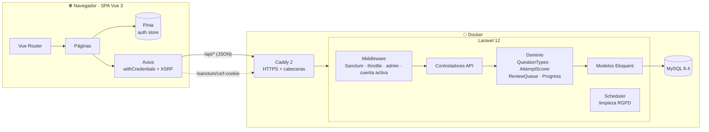

<div align="center">

# 📝 TestMaster

**Crea, comparte y domina cualquier tema a base de tests.**

Plataforma web de exámenes en línea con 7 tipos de pregunta, corrección automática con puntuación parcial,<br>
repaso inteligente de fallos, panel de progreso personal y panel de administración.

[](https://laravel.com)
[](https://www.php.net)
[](https://vuejs.org)
[](https://vitejs.dev)
[](https://www.mysql.com)
[](https://laravel.com/docs/sail)

[](https://tailwindcss.com)
[](https://pinia.vuejs.org)
[](https://laravel.com/docs/sanctum)
[](https://caddyserver.com)
[](https://phpunit.de)
[](#-privacidad-y-seguridad)
[](#-licencia)

[Características](#-características) ·
[Inicio rápido](#-inicio-rápido) ·
[Arquitectura](#-arquitectura) ·
[API](#-api-rest) ·
[Seguridad](#-privacidad-y-seguridad) ·
[Documentación técnica](DOCUMENTATION.md)

</div>

---

## ✨ Características

<table>
<tr>
<td width="50%" valign="top">

### 🧩 Editor de tests
- **7 tipos de pregunta**: opción múltiple, selección múltiple, verdadero/falso, respuesta corta, rellenar huecos, ordenar elementos y numérica con margen.
- Categorías, dificultad, tiempo límite, intentos máximos y nota de corte.
- **Penalización por fallo** configurable (0, ¼, ⅓, ½).
- Barajar preguntas y respuestas, modo **paginado** o **todo en una página**.
- **Tests con contraseña** (guardada con hash).
- **Borrador automático** en el navegador: no pierdes el trabajo si cierras la pestaña.

</td>
<td width="50%" valign="top">

### 🎯 Realización y corrección
- Corrección automática en el servidor, **sin filtrar nunca la solución** al cliente.
- **Puntuación parcial** en selección múltiple, huecos y ordenación.
- Resultados detallados: tu respuesta, la correcta y la explicación.
- Comparativa con la media del test y con tu mejor intento.
- 🔁 **Repasar mis fallos**: rehaz solo las preguntas que fallaste, sin gastar intentos ni afectar a tus estadísticas.

</td>
</tr>
<tr>
<td width="50%" valign="top">

### 📈 Mi progreso
- Resumen: exámenes, aprobados, nota media, repasos y tiempo de estudio.
- 🔥 **Racha de estudio** y calendario de actividad tipo *heatmap* (en tu zona horaria).
- **Dominio por categoría** según tu última respuesta a cada pregunta.
- Lista de tests con fallos pendientes de repasar.
- Historial completo de intentos, filtrable y paginado.

</td>
<td width="50%" valign="top">

### 🛡️ Administración
- Métricas globales y gráficas de los últimos 30 días.
- Gestión de tests: estado, **destacados** en la portada y borrado.
- Gestión de usuarios: rol y **suspensión** inmediata de cuentas.
- CRUD de categorías (icono Font Awesome + color).
- 📜 **Registro de auditoría** de todas las acciones de administración.

</td>
</tr>
</table>

**Y además:** 🌗 tema claro/oscuro con *design tokens* · 📱 diseño responsive · 🔐 sesión en cookie httpOnly + CSRF · 🇪🇺 exportación y borrado de datos (RGPD) · ⚖️ páginas legales, ayuda y contacto.

---

## 🧱 Stack tecnológico

| Capa | Tecnología |
|---|---|
| **Backend** | PHP 8.2+ · Laravel 12 · Eloquent ORM |
| **Autenticación** | Laravel Sanctum en modo SPA (cookie de sesión httpOnly + CSRF) |
| **Frontend** | Vue 3 (Composition API) · Vue Router 4 · Pinia · Axios |
| **Estilos** | CSS con *design tokens* propios · Tailwind CSS 4 · Font Awesome 6 · Wix Madefor Text |
| **Build** | Vite 7 + `laravel-vite-plugin` |
| **Base de datos** | MySQL 8.4 (SQLite admitido en local) |
| **Infraestructura** | Docker con Laravel Sail · Caddy 2 (HTTPS automático) · Supervisor (PHP + scheduler) |
| **Testing** | PHPUnit 11 (tests de feature para tipos de pregunta, repaso, dashboard, admin, seguridad y RGPD) |

---

## 🚀 Inicio rápido

### Requisitos

- [Docker](https://www.docker.com/) y Docker Compose
- [Git](https://git-scm.com/)
- *(Opcional, sin Docker)* PHP 8.2+, Composer, Node.js 18+ y MySQL 8 / SQLite

### Con Docker (Laravel Sail) — recomendado

```bash
# 1. Clona el repositorio
git clone https://github.com/HiImGhost666/TestMaster.git
cd TestMaster

# 2. Configura el entorno
cp .env.example .env
#   → DB_CONNECTION=mysql, DB_HOST=mysql, DB_DATABASE, DB_USERNAME, DB_PASSWORD
#   → SEED_ADMIN_PASSWORD=<contraseña para el admin de prueba>

# 3. Instala las dependencias de PHP
docker run --rm -u "$(id -u):$(id -g)" -v "$(pwd):/var/www/html" -w /var/www/html \
    laravelsail/php84-composer:latest composer install --ignore-platform-reqs

# 4. Arranca los contenedores
./vendor/bin/sail up -d

# 5. Prepara la aplicación
./vendor/bin/sail artisan key:generate
./vendor/bin/sail artisan migrate --seed
./vendor/bin/sail artisan storage:link

# 6. Frontend
./vendor/bin/sail npm install
./vendor/bin/sail npm run dev
```

Abre **http://localhost** 🎉

### Sin Docker

```bash
composer setup     # composer install, .env, key:generate, migrate, npm install, npm run build
php artisan db:seed
composer dev       # servidor + cola + logs + Vite en paralelo
```

### Cuentas de prueba

| Rol | Email | Contraseña |
|---|---|---|
| Usuario | `test@example.com` | `password` |
| Admin | `admin@example.com` | valor de `SEED_ADMIN_PASSWORD` |

> [!TIP]
> Si no defines `SEED_ADMIN_PASSWORD`, el seeder genera una contraseña aleatoria para el admin y la muestra por consola al terminar.

El seeder crea además **8 categorías y 10 tests** de ejemplo (programación, historia, geografía, ciencia, inglés, cultura pop…).

---

## 🏗️ Arquitectura



- **SPA catch-all:** Laravel sirve siempre la vista `app.blade.php` y Vue Router resuelve la ruta en el cliente.
- **Tipos de pregunta como estrategias:** cada tipo implementa `App\Questions\QuestionType` (validar, guardar, presentar, corregir y etiquetar). Añadir un tipo nuevo = una clase + registrarla en `QuestionTypes`.
- **Estadísticas calculadas, no almacenadas:** rachas, dominio y fallos pendientes se derivan de los intentos, así nunca se desincronizan.

### Estructura del proyecto

```
TestMaster/
├── app/
│   ├── Http/Controllers/Api/   # Auth, Account (RGPD), Test, Attempt, Profile, Dashboard
│   │   └── Admin/              # AdminController, AdminCategoryController
│   ├── Http/Middleware/        # EnsureAdmin, EnsureAccountActive
│   ├── Models/                 # User, Test, Question, TestAttempt, AdminAuditLog…
│   ├── Questions/              # QuestionType, QuestionTypes, AttemptScorer, ReviewQueue
│   │   └── Types/              # Un archivo por tipo de pregunta
│   ├── Progress/               # StudyActivity (rachas), CategoryMastery (dominio)
│   └── Support/TestAccess.php  # Quién puede ver / gestionar / hacer un test
├── database/
│   ├── migrations/
│   └── seeders/                # DatabaseSeeder, QuestionSeeder
├── routes/
│   ├── api.php                 # API REST
│   ├── web.php                 # Catch-all de la SPA
│   └── console.php             # Tareas programadas (retención de datos)
├── Vue/                        # Frontend SPA
│   ├── pages/                  # Home, TakeTest, Results, CreateTest, Dashboard, Admin…
│   ├── components/             # base/, admin/, charts/, question/, test/, legal/…
│   ├── composables/            # useTheme, useToast
│   ├── stores/auth.js          # Sesión del usuario (Pinia)
│   ├── api/axios.js            # Cliente HTTP con CSRF
│   └── assets/                 # tokens.css (tema) + styles.css
├── tests/Feature/              # Suites de PHPUnit
├── Caddyfile                   # Proxy inverso HTTPS de producción
├── compose.yaml                # Docker de desarrollo
├── compose.prod.yaml           # Docker de producción (con Caddy)
└── deploy.sh                   # Script de despliegue
```

---

## 🧠 Tipos de pregunta y puntuación

| Tipo | Qué responde el alumno | Puntuación |
|---|---|---|
| ⚪ `multiple_choice` | Una opción | Todo o nada |
| ☑️ `multiple_select` | Una o varias opciones | Parcial: (aciertos − errores) / correctas, mínimo 0 |
| ✅ `true_false` | Verdadero o falso | Todo o nada |
| ✍️ `short_answer` | Texto libre | Todo o nada (ignora mayúsculas y espacios) |
| 🔤 `fill_blank` | Un texto por cada hueco `___` | Parcial: huecos acertados / huecos |
| 🔢 `order_items` | Elementos en orden | Parcial: elementos en su sitio / elementos |
| 🧮 `numeric` | Un número (coma o punto) | Todo o nada, dentro del margen ± |

**Nota final** = puntos obtenidos / puntos totales (nunca por debajo de 0 %). Con penalización activa, una respuesta con 0 aciertos resta `penalización × puntos`; las parciales y las preguntas en blanco no restan.

---

## 🔌 API REST

Todos los endpoints viven bajo `/api` y devuelven JSON. Resumen:

| Área | Endpoints principales | Acceso |
|---|---|---|
| **Auth** | `POST /register` · `POST /login` · `POST /logout` · `GET /me` · `POST /reset-password` | Público / sesión |
| **Catálogo** | `GET /tests` · `GET /tests/featured` · `GET /tests/stats` · `GET /tests/{id}` · `GET /categories` | Público |
| **Tests** | `POST /tests` · `GET /tests/{id}/edit` · `PUT /tests/{id}` · `DELETE /tests/{id}` · `POST /tests/{id}/unlock` | Sesión |
| **Intentos** | `GET /tests/{id}/questions[?mode=review]` · `POST /attempts/submit` · `GET /attempts/{id}/results` | Sesión |
| **Progreso** | `GET /dashboard?tz=` · `GET /dashboard/attempts` | Sesión |
| **Perfil** | `GET /profile/{id}` · `POST/DELETE /profile/avatar` | Público / sesión |
| **Cuenta (RGPD)** | `GET /account/export` · `DELETE /account` | Sesión |
| **Admin** | `/admin/metrics` · `/admin/tests` · `/admin/users` · `/admin/categories` · `/admin/audit` | Rol `admin` |

> [!NOTE]
> La SPA se autentica con la cookie de sesión de Sanctum: antes de `login`/`register` hay que pedir `GET /sanctum/csrf-cookie`. Todos los detalles (cuerpos, respuestas y códigos de error) están en [DOCUMENTATION.md](DOCUMENTATION.md#62-api-rest--endpoints).

---

## 🔐 Privacidad y seguridad

| | |
|---|---|
| 🍪 **Sesión** | Cookie httpOnly cifrada + protección CSRF; el token nunca es accesible desde JavaScript. |
| 🚦 **Rate limiting** | Login/registro (5/min por email+IP, 20/min por IP), API general (120/min), contraseña de tests y operaciones sensibles (5/min). |
| 🔑 **Contraseñas** | bcrypt, mínimo 8 caracteres; cambiarla cierra el resto de sesiones. |
| 🙈 **Soluciones** | Cada tipo de pregunta decide qué ve el alumno: nunca se envían respuestas correctas antes de corregir. |
| 👮 **Roles** | Middleware `admin` en el servidor; las cuentas suspendidas pierden el acceso en su siguiente petición. |
| 🧱 **Cabeceras** | Caddy añade HSTS, CSP estricta, `X-Frame-Options: DENY`, `nosniff`, Referrer y Permissions Policy. |
| 🇪🇺 **RGPD** | Consentimiento registrado con versión de la política, exportación de datos en JSON, borrado de cuenta (con tests públicos anonimizados), minimización de IP/user-agent y limpieza programada de sesiones y tokens. |

---

## 🧪 Tests

```bash
./vendor/bin/sail artisan test        # con Docker
composer test                         # sin Docker
```

| Suite | Cubre |
|---|---|
| `QuestionTypesTest` | Validación, corrección y puntuación parcial de los 7 tipos, penalizaciones |
| `ReviewModeTest` | Cola de fallos pendientes y modo repaso |
| `DashboardTest` | Rachas, zona horaria, dominio por categoría e historial |
| `AdminTest` | Permisos, destacados, suspensión, categorías y auditoría |
| `TestPasswordTest` | Bloqueo y desbloqueo de tests con contraseña |
| `SecurityGdprTest` | Consentimiento, rate limiting, avatares, privacidad del perfil, exportación y borrado de cuenta |

---

## 🌍 Despliegue en producción

```bash
# .env de producción: APP_ENV=production, APP_DEBUG=false, APP_DOMAIN=tu-dominio.com,
#                     SESSION_SECURE_COOKIE=true, credenciales de MySQL
./deploy.sh
```

`deploy.sh` levanta `compose.prod.yaml` (app + MySQL + **Caddy** con certificado HTTPS automático), espera a MySQL, limpia la caché, ejecuta las migraciones y compila el frontend. El contenedor de la app ejecuta también el **scheduler** de Laravel (Supervisor) para las tareas de retención de datos.

---

## 🗺️ Roadmap

- [x] 7 tipos de pregunta con puntuación parcial y penalización
- [x] Repaso de fallos
- [x] Panel "Mi progreso" con rachas y dominio por categoría
- [x] Panel de administración con auditoría
- [x] Autenticación SPA por cookie y cumplimiento RGPD
- [ ] Grupos / clases con tests asignados
- [ ] Comentarios y valoraciones de tests
- [ ] Seguir a otros usuarios
- [ ] Imágenes, audio y vídeo en las preguntas
- [ ] Gamificación: puntos, niveles e insignias
- [ ] Recuperación de contraseña por email

---

## 🤝 Contribuir

1. Haz un **fork** del repositorio.
2. Crea una rama: `git checkout -b feat/mi-mejora`.
3. Escribe tus cambios **con tests** (`php artisan test` debe pasar).
4. Usa [Conventional Commits](https://www.conventionalcommits.org/es/) (`feat:`, `fix:`, `docs:`…).
5. Abre un **Pull Request** explicando qué cambia y por qué.

¿Vas a añadir un tipo de pregunta? Mira la sección [Cómo añadir un tipo de pregunta](DOCUMENTATION.md#85-cómo-añadir-un-tipo-de-pregunta) de la documentación técnica.

---

## 📄 Licencia

Distribuido bajo licencia **MIT**.

<div align="center">

Hecho con ❤️, ☕ y mucho Laravel + Vue

⭐ Si te resulta útil, ¡deja una estrella al repo!

</div>
